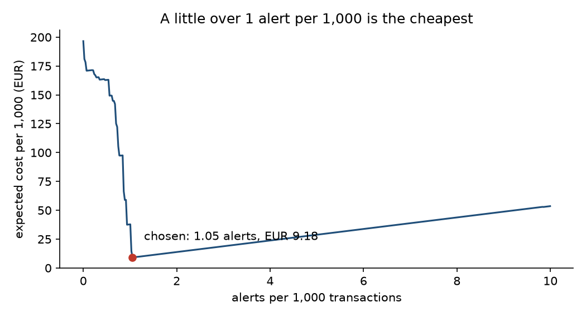
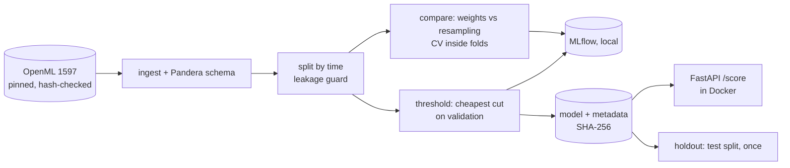

# fraud-detection-pipeline

Flagging fraudulent card transactions with a small pipeline built the way a team would run it:
- config-driven ingestion and schema validation;
- leakage checks that stop training;
- tracked experiments, with a threshold set by what mistakes cost;
- a scoring API in Docker, and CI that runs the whole thing.

**Result:** on the test split (scored once), the model catches **37 of 52 frauds at about 1 alert per 1,000 transactions**, with PR-AUC 0.73 (95% CI 0.60 to 0.84). It cut expected losses by 95% on validation but only by **56%** on test, because four large frauds slipped through. Read the [model card](MODEL_CARD.md) before trusting any of it.

## Demo

```text
$ export FRAUD_API_KEY=$(python -c "import secrets; print(secrets.token_urlsafe(32))")
$ make serve
$ curl -s -X POST 127.0.0.1:8000/score -H "X-API-Key: $FRAUD_API_KEY" \
       -H "Content-Type: application/json" --data @four_transactions.json
{"model_version":"7a2ce68df210","threshold":0.8125609434496658,
 "results":[{"score":0.965357,"alert":true},{"score":0.999732,"alert":true},
            {"score":0.00004,"alert":false},{"score":0.000019,"alert":false}]}
```

Those are two real validation frauds and two legitimate transactions. A request without the key gets 401, and the service won't start without a key of 32 or more characters.



## Results

Model comparison, PR-AUC (time-ordered 5-fold CV on train, then validation):

| | CV mean | Validation |
|---|---|---|
| **Gradient boosting, class weights (chosen)** | **0.791** | 0.847 |
| Gradient boosting, SMOTE | 0.779 | 0.848 |
| Gradient boosting, undersampling | 0.763 | 0.838 |
| Logistic regression, SMOTE | 0.747 | 0.813 |
| Logistic regression, class weights | 0.725 | 0.839 |
| Logistic regression, no weighting | 0.635 | 0.782 |
| Gradient boosting, no weighting | 0.589 | 0.002 |

At the cost-based threshold (missed fraud = its amount, false alarm = €5):

| | Validation | Test |
|---|---|---|
| Frauds caught | 43 / 56 | 37 / 52 |
| Alerts per 1,000 | 1.05 | 1.10 |
| Expected cost per 1,000 | €9.18 | €63.32 (€15 to €135) |
| With no model | €196.57 | €144.40 |

What the work found:

- **Resampling before the split is a big leak.** SMOTE on the whole training set, then cross-validation, reports PR-AUC 0.983. Done inside the folds, it's 0.761.
- **Unweighted boosting collapses.** It memorises the 384 training frauds and gives new frauds a score of about 10⁻¹⁰⁸: confidently wrong.
- **Half of all frauds are under €10** (card testing). At €5 a review, catching them costs more than missing them, so the threshold leans towards the large frauds. On test, that's exactly where it failed: four frauds of €187 to €1,097 were missed.
- **The test result is fragile.** With about 50 frauds, a few large misses decide the cost.
- **Three bugs the tests or a re-check caught:**
  - YAML reads an unquoted all-digit hash as a number;
  - the first threshold sweep sampled cut points and missed the cheapest one;
  - a NaN in a request turned FastAPI's validation error into a 500.

## Features

- **Pinned, hash-checked download** of the data, and a strict [Pandera](https://pandera.readthedocs.io) schema: exactly 31 columns in order, ranges, no missing values.
- **Config in YAML,** validated by Pydantic with unknown keys refused. Its SHA-256 is saved with every model.
- **Split by time** at timestamp boundaries, so duplicates can't straddle splits. A leakage guard runs before every training run.
- **Models saved with full metadata:** data and config hashes, git commit and dirty flag, versions, metrics. They're loaded only from hash-checked bytes.
- **MLflow tracking** on a local SQLite store, as an optional extra.
- **FastAPI `POST /score`:**
  - a constant-time API key check;
  - strict input with no extra fields, finite numbers and ranges;
  - a 256 KB cap and a required `Content-Length`;
  - up to 100 transactions per request;
  - no `/docs`;
  - logs and errors without transaction values.
- **A Docker image** with runtime dependencies only, a non-root user and a health check, published to localhost.
- **CI:** ruff, pytest, pip-audit (including the MLflow extra) and Gitleaks, plus a smoke job. The smoke job downloads the real data, trains, builds the image, scores real transactions through the container, and scans the image with Trivy.

## Stack

Python 3.12, uv, pandas, scikit-learn, imbalanced-learn, Pandera, Pydantic, MLflow, FastAPI, uvicorn, Docker, pytest, ruff, GitHub Actions.

## Architecture



The decisions, threat model and limitations are in [docs/ARCHITECTURE.md](docs/ARCHITECTURE.md), and the model's intended use is in [MODEL_CARD.md](MODEL_CARD.md).

## Quick start

```bash
uv sync --extra tracking   # without the extra, runs work but are not logged to MLflow
make all                   # data -> baseline -> comparison -> final model (about 7 minutes)
make test
export FRAUD_API_KEY=...   # 32+ characters
make serve                 # or: make docker && make serve-docker
```

## Structure

```text
config/pipeline.yaml     every setting a run depends on
src/fraud_pipeline/      config, ingest, schema, split, evaluate, train, compare, threshold, tracking, service, holdout
notebooks/               01 EDA · 02 class weights vs resampling · 03 threshold
scripts/smoke.py         the CI smoke check against a running service
reports/                 JSON results with hashes, figures
tests/                   100 tests: leakage, bad config, bad data, bad requests, refusals
```

## Limitations

- **Two days of 2013 data from one issuer,** and a test split that covers one evening.
- **About 50 frauds each in validation and test,** so every figure has wide intervals. The cost result in particular depends on a few large frauds.
- **Anonymised PCA features.** No explanation in terms of real fields, and no way to score real-world transactions.
- **The cost model counts reviews, not the customer's cost of a false alarm.**
- **The API has one key and no rate limit.** It's built for a local demo.
- **The Docker image and the CI smoke job haven't run yet.** GitHub Actions is blocked on this account, and Docker Desktop didn't start on the development laptop.

## License

MIT. The data isn't included; see the model card for its source and terms.
