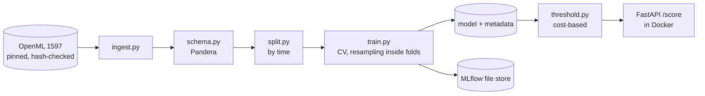

# Architecture

## Context

A small, end-to-end ML pipeline built the way a team would run it: config-driven ingestion, schema validation, reproducible training with metadata, experiment tracking, a scoring API in Docker, and CI that runs the whole pipeline on a sample. The model is the less interesting part. The point is that every number can be traced to the data, code and config that produced it.

The task is to flag fraudulent card transactions. The questions it answers:

1. **How many frauds are caught for a given number of alerts?** Recall at a fixed review budget, and PR-AUC. Accuracy is meaningless at 0.17% fraud.
2. **Where should the alert threshold sit?** Chosen by cost, with a missed fraud costing its amount and a false alarm costing a review, not by 0.5.
3. **Do class weights or resampling help, done correctly inside cross-validation?** Resampling before the split is a classic leak, and a test will prove it isn't done.

## Data

| Item | Proposal | Notes |
|---|---|---|
| Source | OpenML dataset 1597 (`creditcard`): the ULB / Worldline card transactions from September 2013 | 284,807 transactions over two days, 492 frauds (0.172%). 28 PCA components (V1 to V28), plus `Time` and `Amount` |
| Licence | OpenML lists it as "Public". The original Kaggle copy (mlg-ulb) is listed under the Open Data Commons Database Contents License (DbCL 1.0) | The data isn't committed or re-hosted; a script downloads it. CI uses a synthetic fixture, not a sample of the real data |
| Download | OpenML dataset 1597, version 1, from its Parquet URL (`data.openml.org/datasets/0000/1597/dataset_1597.pq`). The ARFF's published MD5 is `178bcf9bb1f31a3dfe12d0e577884add`; our own SHA-256 of the Parquet file is recorded in the repo on day 2 and checked on every load | Scriptable and pinned. A changed file fails the hash check instead of silently changing results |
| Known issues | About 1,000 exact duplicate rows; anonymised features, so no domain reading of the PCA components; only two days | Duplicates are counted, and test rows that repeat train rows are reported |

## Known problems (to measure, not hide)

- **Time ordering.** Transactions span two days. A random split lets the model see later fraud patterns, so the main split is by time (first ~70% train, then validation, then test), with a random stratified split shown only for comparison.
- **Resampling leakage.** SMOTE or undersampling applied before splitting leaks synthetic copies of test frauds. Resampling lives inside an `imblearn` pipeline, so it only ever touches training folds, and a test checks this.
- **Duplicates across splits.** Counted and reported. Exact duplicates that span a split boundary are dropped from the later split.
- **`Amount` scale and `Time` as a feature.** `Time` is seconds since the first transaction, so as a raw feature it only says "which day". It's turned into hour of day or left out, and the ablation shows which.

## Setup

| Item | Choice | Why |
|---|---|---|
| Split | By time: train 70%, validation 15%, test 15% (scored once) | Fraud patterns drift. The test set comes after everything the model saw |
| Metrics | PR-AUC, recall at 1 alert per 1,000 transactions, expected cost per 1,000 transactions, precision at the chosen threshold | They match how a fraud team works: a fixed review capacity, with money lost on misses |
| Cost model | Missed fraud = its `Amount`; false alarm = a fixed review cost (€5, configurable) | Simple, stated, and easy to change in config |
| Baselines | Flag nothing; flag the largest amounts; logistic regression | A model has to beat "review the big ones" |
| Models | Logistic regression and HistGradientBoosting, each with class weights or with under/oversampling inside CV | The comparison the plan asks for |
| Tracking | MLflow with a local file store (no server, nothing in the cloud) | Run parameters, metrics, data hash and git commit in one place |

## Components

| Component | Responsibility |
|---|---|
| `config/*.yaml` | Data source, split fractions, costs, model settings. Validated with Pydantic, unknown keys refused, the hash quoted (YAML reads an all-digit string as a number). The file's SHA-256 is saved with every model |
| `ingest.py` | Pinned download, hash check, Parquet cache |
| `schema.py` | Pandera schema: exactly the 31 expected columns in order, all numeric with no missing values, `Time` within two days, `Amount ≥ 0`, PCA components within ±1,000, `Class ∈ {0, 1}`, at least one row. A failing table stops the pipeline |
| `split.py` | Time-ordered split, duplicate report |
| `train.py` | CV with resampling inside folds, model metadata (data hash, git commit, config hash) saved next to each model |
| `threshold.py` | Cost-based threshold chosen on validation |
| `service/` | FastAPI `POST /score`: Pydantic input (30 numeric fields with ranges), API key from the environment, request size cap, no transaction data in logs |
| `Dockerfile` | Non-root, slim base, model loaded from hash-checked bytes |
| `Makefile` | `make all` runs ingest → validate → split → train → threshold → evaluate |

## Threat model (STRIDE, short)

| | Threat | Mitigation |
|---|---|---|
| Spoofing | A caller without permission scores transactions | API key from the environment, compared in constant time. The service refuses to start without one |
| Tampering | The cached data or the model file is changed | SHA-256 checks; the model is loaded only from hash-checked bytes |
| Repudiation | A score can't be traced to a model version | Every response carries the model's version id, and every model carries its data hash and git commit |
| Information disclosure | Transaction data in logs | Logs record the request id, latency and decision, never the input fields |
| Denial of service | Huge or malformed requests | Request size cap, strict Pydantic schema, a batch limit, timeouts |
| Elevation (misuse) | Used to block real customers automatically | The README says it's a demo on two-day 2013 data. The service returns a score and an alert flag, not a block |

## Decisions

| # | Decision | Why |
|---|---|---|
| 1 | OpenML 1597 version 1, pinned by URL and SHA-256, never committed | Reproducible and within the licence |
| 2 | Split by time: train 70%, validation 15%, test 15%, scored once | Fraud patterns drift; the test set comes after everything the model saw. It holds only about 70 frauds, so its intervals are wide and are reported as such |
| 3 | Main metrics: PR-AUC, recall at 1 alert per 1,000 transactions, expected cost per 1,000 transactions | Accuracy is meaningless at 0.17% fraud; a fraud team has fixed review capacity and loses money on misses |
| 4 | Cost model: a missed fraud costs its `Amount`, a false alarm costs €5 (configurable) | Simple, stated, and changeable in config |
| 5 | Resampling only inside an `imblearn` pipeline, so it never touches validation or test rows; a test proves it | Resampling before the split is a classic leak |
| 6 | Config in YAML, validated with Pydantic, unknown keys refused | A typo in config should fail loudly, not fall back to a default |
| 7 | Pandera schema check at ingest; a failing batch stops the pipeline | Bad data should never reach training or scoring |
| 8 | Every model is saved with its data hash, config hash and git commit, and loaded only from hash-checked bytes | Any number can be traced to its inputs, and a pickle runs code when loaded |
| 9 | MLflow with a local file store, no server | Tracking without running anything in the cloud |
| 10 | The FastAPI service and Docker image stay local; no AWS deploy | Agreed scope; ThreatLens already covers the AWS side |

## Limitations (known before starting)

- Two days of transactions from 2013, from one European issuer. Fraud has changed since.
- The features are PCA components, so the model can't be explained in terms of real transaction fields.
- About 70 frauds in the test slice, so test results have wide intervals.
- No customer or merchant history, which real fraud systems rely on.
